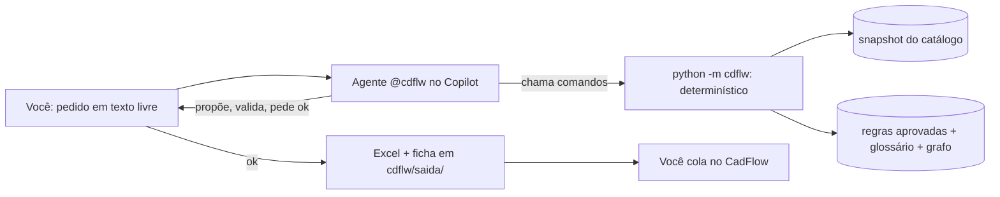

# cdflw — assistente de regras de cadastro (CadFlow) no VS Code

Você descreve a regra em texto livre no chat do Copilot. O agente `@cdflw` confere tabela e
campos no Unity Catalog, olha o que já existe, escreve a regra nos 15 campos do CadFlow, valida
contra o padrão da Governança e grava num Excel local e numa ficha para você colar no CadFlow.



## Onde cada coisa fica

```
<repositório>/                 a pasta que o VS Code abre
  .github/
    agents/cdflw.agent.md        o agente @cdflw (modelo fixo, fluxo passo a passo)
    skills/regras-cadflow/       o padrão CadFlow (15 campos, SE/ENTÃO/SENÃO, o que nunca citar) + references/ geradas
    skills/nova-regra/           /nova-regra
    skills/refazer/              /refazer
    skills/atualizar/            /atualizar
    copilot-instructions.md      ganha um bloco "cdflw:inicio ... cdflw:fim"
  cdflw/                         O PROJETO
    __main__.py                  linha de comando + trilha da conversa
    nucleo.py                    texto, configuração, base da Governança, validador, gravação, referências
    catalogo.py                  Databricks: guarda de SQL, Unity Catalog, cluster, testes no dado
    grafo.py                     grafo das regras, visões de governança, grafo.html
    config.toml                  configuração da equipe (catálogo, listas, mapa de tabelas, colunas do Excel)
    config.local.toml            a sua (profile, cluster, modelo); fora do git
    base/                        ARQUIVOS DA GOVERNANÇA que você copia (fora do git)
    dados/                       tudo que o /atualizar gera (fora do git)
    saida/                       regras novas: Excel, fichas, trilha (fora do git)
    docs/MANUAL.md               tudo que o agente faz, desfazer/refazer, validador, manutenção
    tests/, exemplos/            testes (pytest) e dados sintéticos; opcionais
```

## Pré-requisitos

Python 3.11+ com `openpyxl` e `networkx` (`pip install openpyxl networkx`); `databricks-sdk` já vem
com o Databricks Connect. VS Code com GitHub Copilot Chat e a extensão Databricks conectada na raiz
do repositório (é dela que o cdflw lê profile e cluster, em `.databricks\project.json`).

## Primeira vez

1. Copie os arquivos para as pastas acima (ou clone o repositório que já os tem).
2. Na raiz do repositório, no terminal do VS Code:

```
python -m cdflw configurar --uc <catalogo>.<schema>
python -m cdflw instalar
```

   O `instalar` cria `cdflw\base`, `dados` e `saida`, confere os arquivos do Copilot em `.github`,
   acrescenta o bloco do cdflw em `.github\copilot-instructions.md` e liga `chat.useAgentSkills`
   no `.vscode\settings.json`.
3. Copie para `cdflw\base\` os arquivos da Governança: `Regras de governanca.md`,
   `regras_aprovadas_*.md` e, se tiver, o export do CadFlow em `.xlsx`.
4. Recarregue a janela do VS Code. Em Chat > Agent Customizations deve aparecer Agents 1, Skills 4.
5. No Copilot Chat: `/atualizar`. Depois `python -m cdflw configurar --aceitar-mapa` para confirmar
   o mapa sigla → prefixo → tabela que ele sugeriu.

Sem a extensão Databricks: `python -m cdflw recursos` e
`python -m cdflw configurar --local --profile <profile> --cluster-nome "<cluster>"`.

## Os comandos de chat

| Você digita | O que acontece |
|---|---|
| `/atualizar` | lê `cdflw\base`, tira o retrato do catálogo e da linhagem, monta glossário e grafo, calibra o validador nas aprovadas, regenera as referências da skill |
| `/nova-regra <pedido>` | o fluxo completo de criação, com o agente `@cdflw` selecionado |
| `/refazer <código>` | desfaz uma regra (ou a família dela) já gravada pelo cdflw e recomeça |

Resultado de uma regra: `cdflw\saida\regras_novas.xlsx` (uma linha por regra, colunas na ordem do
formulário), `cdflw\saida\fichas\<codigo>.md` (campo a campo, para colar), `cdflw\dados\grafo.html`
(o grafo com a nova dentro) e `cdflw\saida\_trilha.html` (o caminho que o agente percorreu).

## Comandos do pacote (o agente usa estes; você pode usar também)

```
python -m cdflw status
python -m cdflw tabela <nome ou sigla>
python -m cdflw campo <SIGLA> [<SIGLA> ...]
python -m cdflw relacionadas --campos A,B --tabela SIGLA --tipo Validação
python -m cdflw proximo-codigo --tabela SIGLA --tipo Validação [--rn PFX.RN.1]
python -m cdflw validar cdflw/saida/_ficha.json --pedido "texto" [--junto COD1,COD2]
python -m cdflw gravar cdflw/saida/_ficha.json
python -m cdflw desfazer <codigos> [--cadeia|--lote id] [--listar]
python -m cdflw incluir-tabela catalogo.schema.tabela --siglas A,B
python -m cdflw cluster [--ligar] [--esperar --max 240]          # código de saída 2 = ainda subindo
python -m cdflw perfil <tabela> <SIGLA> | testar-regra ficha.json | exemplos <tabela> <SIGLA> --onde "<predicado>"
python -m cdflw dominio <TABELA_DOMINIO> | sobreposicao ficha.json --com <codigo>
python -m cdflw explorar <alvo> | impacto <alvo> | redundancias | cadeias --so-quebradas | cobertura | dimensoes
python -m cdflw trilha [--abrir | --nova "motivo" | --exportar | --limpar | --ligar | --desligar]
python -m cdflw configurar --aceitar-mapa | --uc catalogo.schema | --local --profile ... --cluster-nome ... | --local --modelo "..."
python -m pytest cdflw/tests -q
```

Toda saída de comando também vai para `cdflw\saida\_ultimo_comando.txt` (o agente lê de lá quando o
terminal não devolve saída). Manual completo: `cdflw\docs\MANUAL.md`.

## Atualizar o cdflw

Copie por cima os arquivos que mudaram (`python -m cdflw status` mostra a versão instalada), rode
`python -m cdflw instalar` e `/atualizar` se skill, base ou validador mudaram. `config.toml` e
`config.local.toml` são seus: não os sobrescreva sem comparar.
