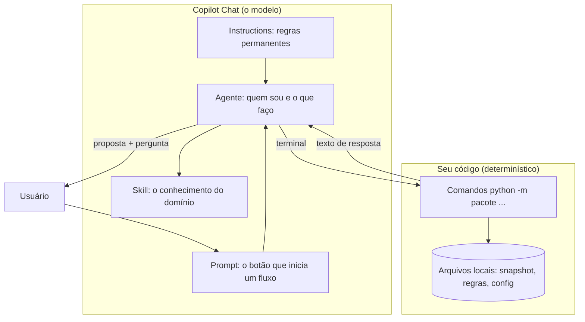
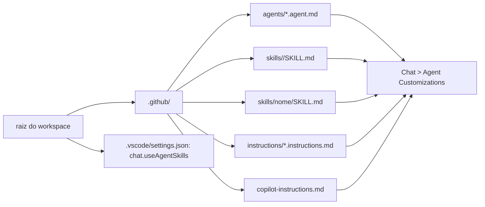
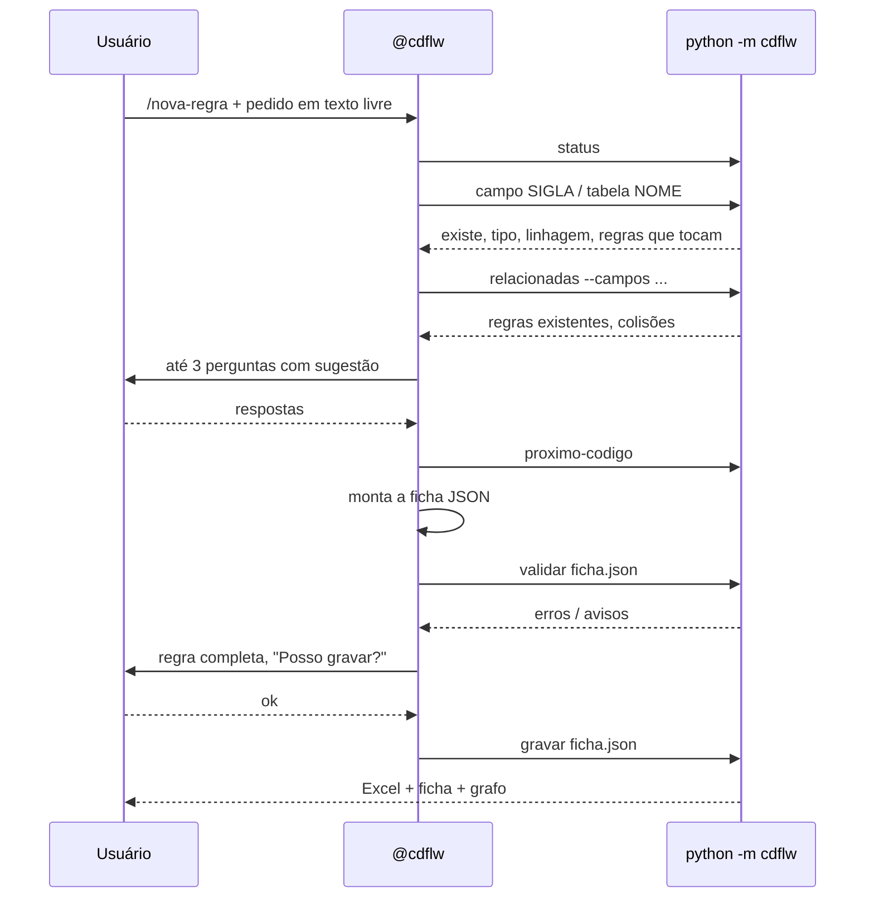
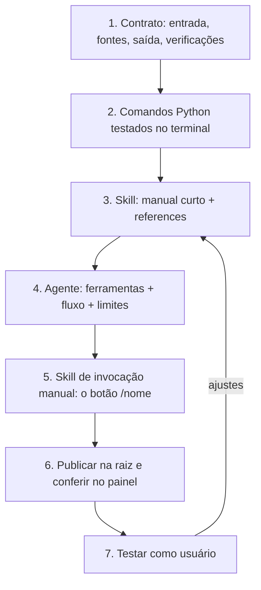

# Tutorial: como o VS Code e o Copilot foram configurados, e como criar outro agente nos mesmos moldes

Este tutorial explica, do zero, tudo que foi preciso configurar para o `@cdflw` existir, e
mostra como repetir a receita para um agente novo. Não exige experiência anterior com
customização do Copilot. Os diagramas estão em Mermaid; abra em um visualizador de Markdown
que o renderize (no VS Code, a extensão "Markdown Preview Mermaid Support").

---

## 1. A ideia em um parágrafo

Um agente do Copilot é só texto: arquivos Markdown que dizem ao modelo quem ele é, o que sabe e
o que pode fazer. O que torna o agente **confiável** não é o texto, é o que ele chama: comandos
de linha de comando que leem dados reais e respondem sempre a mesma coisa. O modelo conversa e
redige; o código confere. Esse é o molde do cdflw e é o que você vai repetir.



---

## 2. Os cinco tipos de arquivo que o Copilot lê

O Copilot procura customizações em lugares fixos **da pasta aberta no VS Code** (a raiz do
workspace). Não adianta colocar em subpasta.

| Tipo | Caminho (na raiz do workspace) | Quando entra no contexto | Para que serve |
|---|---|---|---|
| Instruções gerais | `.github/copilot-instructions.md` | sempre | regras que valem para toda conversa no workspace |
| Instructions por arquivo | `.github/instructions/<nome>.instructions.md` | quando um arquivo aberto bate no `applyTo` | convenções de código de uma pasta |
| Skill de invocação manual (substitui o prompt file) | `.github/skills/<nome>/SKILL.md` com `disable-model-invocation: true` | quando o usuário digita `/<nome>` | um fluxo pronto, com passos |
| Agente | `.github/agents/<nome>.agent.md` | quando o usuário escolhe `@<nome>` no seletor | persona, modelo fixo, fluxo, limites |
| Skill | `.github/skills/<nome>/SKILL.md` + `references/` | quando o modelo julga relevante (pela `description`) | conhecimento de domínio, carregado sob demanda |

Também existe o nível de usuário (`%USERPROFILE%\.copilot\skills` e
`%APPDATA%\Code\User\prompts`), que vale em qualquer workspace. O cdflw não usa, de propósito:
o agente depende dos comandos daquele workspace, então pertence ao workspace.

### 2.1 O que cada arquivo tem na cabeça (frontmatter)

Todos começam com um bloco YAML entre `---`. É ele que o VS Code lê para montar os menus.

**Agente** (`.agent.md`):
```yaml
---
name: meuagente
description: 'Uma frase dizendo o que ele faz (aparece no seletor)'
model: 'Claude Sonnet 5.5'
---
```
Fixe o modelo. Com "Auto" o Copilot pode escolher um modelo caro ou fraco demais para a tarefa.

**Skill de invocação manual** (o antigo "prompt file"; o Copilot harness, padrão desde outubro
de 2026, não carrega `*.prompt.md`):
```yaml
---
name: meu-fluxo
description: 'O que o /meu-fluxo faz'
argument-hint: 'o que digitar depois do comando'
disable-model-invocation: true
user-invocable: true
---
```
`disable-model-invocation: true` faz a skill rodar só quando alguém digita `/meu-fluxo`; sem isso o
modelo pode carregá-la sozinho pela `description`. Uma skill não escolhe agente nem modelo: se o
fluxo depende do seu agente, escreva isso no corpo ("este fluxo é para o @meuagente; se não for
ele, peça ao usuário para selecionar") e mantenha o modelo fixo no `.agent.md`.

**Skill de conhecimento** (`SKILL.md`):
```yaml
---
name: minha-skill
description: 'Quando usar: ... Use ao fazer X, Y ou Z.'
---
```
A `description` é o gatilho: o modelo decide carregar a skill lendo só ela. Escreva o "quando".
O `name` tem que ser igual ao nome da pasta, só minúsculas, números e hífens. Arquivos de apoio
só são carregados se o `SKILL.md` os **referenciar com link Markdown** (`[padrão](references/padrao.md)`).

**Instructions** (`.instructions.md`):
```yaml
---
applyTo: 'src/meuprojeto/**'
description: 'Convenções do meu projeto'
---
```

### 2.2 Configurações do VS Code necessárias

No `.vscode/settings.json` da raiz do workspace:

```json
{
  "chat.useAgentSkills": true,
  "files.encoding": "utf8"
}
```

A primeira liga as skills. A segunda evita o problema clássico de acentos virarem `ç` quando
um arquivo é lido com a codificação errada. Confira depois em **Chat → Agent Customizations**:
o painel lista Instructions, Prompts, Agents e Skills encontrados no workspace, com contadores.
Se um contador está em zero, o arquivo está no lugar errado ou com a extensão errada.



---

## 3. O molde do cdflw, peça por peça

### 3.1 A fonte fica no projeto; a raiz recebe uma cópia

O cdflw guarda seus arquivos em `cdflw/.github/` e um comando (`python -m cdflw
instalar`) copia para `<raiz>/.github/`. Motivo: o projeto vira um pacote só, versionável, e a
cópia na raiz é descartável. Se você for criar um agente pequeno, pode escrever direto na raiz;
se for um projeto, faça como o cdflw.

### 3.2 O agente (`cdflw.agent.md`) tem quatro partes

1. **Quem é e o que nunca faz** ("trabalhe em português, uma regra por vez, nunca invente campo").
2. **As ferramentas**: uma tabela "para X, rode o comando Y". O agente não adivinha comandos.
3. **O fluxo numerado**: entender → confirmar dados → olhar o que existe → perguntar o que falta
   → montar → validar → mostrar → só gravar com "ok".
4. **O tom**: curto, perguntas numeradas, discorda em uma frase e aceita a decisão do usuário.

### 3.3 A skill (`regras-cadflow/SKILL.md`) é o manual do domínio

Curta no arquivo principal (os campos, os verbos, o que nunca fazer) e detalhada em
`references/` (o padrão completo, exemplos aprovados, glossário, tabelas). O modelo lê o
principal quando a skill dispara e abre as referências só se precisar. Isso economiza contexto
e, portanto, crédito.

As referências do cdflw são **geradas** por código a partir dos dados reais (`/atualizar`).
Escrever referência à mão envelhece; gerar mantém sincronizado.

### 3.4 Os comandos são o chão firme

Tudo que pode ser verificado é um comando Python com `argparse`, sem modelo nenhum:

| Pergunta do agente | Comando |
|---|---|
| esse campo existe? de onde vem? | `campo SIGLA` |
| o que já existe sobre isso? | `relacionadas --campos ...` |
| qual o próximo código? | `proximo-codigo --tabela ... --tipo ...` |
| a regra está no padrão? | `validar ficha.json` |
| gravar | `gravar ficha.json` |

Dois detalhes que custaram para aprender:

- **Saída espelhada em arquivo.** Em algumas máquinas o chat não captura o que o terminal
  imprime. Todo comando do cdflw grava uma cópia em `saida/_ultimo_comando.txt`, e o agente é
  instruído a ler o arquivo quando o terminal vier vazio.
- **Ficha JSON como contrato.** O agente escreve a proposta num JSON com chaves fixas; `validar`
  e `gravar` leem esse JSON. Assim o texto do modelo nunca entra direto no Excel.

### 3.4b Olhar o dado, com guarda

Quando o agente pode consultar o dado (perfil do campo, quantos registros a regra marcaria), a
proposta deixa de ser opinião. A regra do molde: o agente **escreve o predicado**, o código
**decide se executa**. A guarda (`sql_guarda.py`) só deixa passar `SELECT`/`WITH` sem palavras de
escrita, impõe amostragem e mascara valores. O agente nunca recebe um valor real por padrão, só
contagens e padrões. Se um dia o seu agente precisar olhar dados, copie esse arranjo em vez de
dar a ele um terminal SQL livre.

### 3.5 Calibração: o validador precisa reconhecer o que já é aprovado

O cdflw roda o validador sobre as regras que a Governança já aprovou. Se uma aprovada
reprova, o validador é que está errado. Foi assim que descobrimos que a Governança escreve
"A regra verifica se ... e enriquece" em Enriquecimentos, e o validador foi ajustado. Sem
calibração, o agente "corrige" o que a casa considera certo.



---

## 4. Receita: criar um agente novo nos mesmos moldes

Vamos supor um agente novo, `@descreve-tabela`, que escreve a descrição de negócio de uma
tabela do catálogo a partir das colunas e das regras que a tocam. O caminho é o mesmo para
qualquer outro.

### Etapa 1 — Decida o contrato antes de escrever prompt

- **Entrada:** o que o usuário diz (nome da tabela).
- **Fontes de verdade:** o que o agente pode consultar (snapshot do catálogo, regras).
- **Saída:** um JSON com chaves fixas (`tabela`, `descricao`, `campos_chave`, `regras_relacionadas`).
- **Verificações:** o que o código confere (tabela existe; descrição sem sigla; tamanho).
- **Onde grava:** um arquivo por resultado (`saida/descricoes/<tabela>.md`).

Se não dá para escrever essa lista, o agente ainda não está pronto para ser escrito.

### Etapa 2 — Escreva os comandos primeiro

Crie um pacote Python com um `__main__.py` e `argparse`. No cdflw, cada comando é uma função
`cmd_<nome>(cfg, args)` que imprime texto simples (o modelo lê texto, não objetos) e também
grava a saída em arquivo. Reaproveite o que já existe: `uc.descrever_tabela`,
`grafo.relacionadas`, `validar.Contexto`.

Um comando novo mínimo:

```python
def cmd_descrever(cfg, a):
    snap = uc.carregar_snapshot(cfg)
    for linha in uc.descrever_tabela(snap, a.nome):
        _p(linha)
    g = grafo.carregar(cfg.dados / "grafo.json")
    for r in grafo.relacionadas(g, [], a.nome.upper())[:10]:
        _p(f"regra {r['codigo']}: {r['nome']}")
    return 0
```

Teste no terminal antes de envolver o modelo. Se o comando não responde bem a você, não vai
responder bem ao agente.

### Etapa 3 — Escreva a skill

`.github/skills/descricao-tabelas/SKILL.md`:

```markdown
---
name: descricao-tabelas
description: 'Padrão para escrever a descrição de negócio de uma tabela do catálogo. Use ao documentar ou revisar a descrição de uma tabela.'
---

# Descrição de tabela, no padrão da casa

- 2 a 4 frases, linguagem de negócio, sem sigla de campo.
- Primeira frase: o que a tabela representa (pessoa, contrato, evento).
- Segunda: granularidade (uma linha por ...).
- Depois: origem e regras de qualidade relevantes.
- Nunca inventar: se o catálogo não diz, pergunte.

Exemplos aprovados em `references/exemplos.md`.
```

Deixe o arquivo principal com menos de 80 linhas. O resto vai em `references/`.

### Etapa 4 — Escreva o agente

`.github/agents/descreve-tabela.agent.md`:

```markdown
---
name: descreve-tabela
description: 'Escreve a descrição de negócio de uma tabela do catálogo com base nas colunas e nas regras que a tocam'
model: 'Claude Sonnet 5.5'
---

# Agente descreve-tabela

Você escreve descrições de tabela no padrão da skill `descricao-tabelas`. Em português, uma
tabela por vez, sem inventar.

## Ferramentas (terminal, a partir da raiz do workspace)

| Para | Comando |
|---|---|
| ver colunas e regras da tabela | `.venv\Scripts\python.exe -m cdflw descrever <nome>` |
| validar a descrição | `.venv\Scripts\python.exe -m cdflw validar-descricao ficha.json` |

Se o terminal devolver saída vazia, leia `cdflw/saida/_ultimo_comando.txt`.

## Fluxo
1. Rode `descrever <nome>`. Se a tabela não existir, pergunte qual é (mostre as parecidas).
2. Leia a skill. Escreva a descrição no padrão.
3. Grave a ficha JSON em `saida/_ficha_descricao.json` e rode `validar-descricao`.
4. Mostre a descrição e pergunte "Posso gravar?". Só grave com "ok".

## Nunca
- Citar sigla de campo na descrição.
- Afirmar origem de dado que o comando não mostrou.
```

### Etapa 5 — Escreva o "botão" (skill de invocação manual)

`.github/skills/descrever-tabela/SKILL.md`:

```markdown
---
name: descrever-tabela
description: 'Escreve a descrição de negócio de uma tabela do catálogo. Invoque com /descrever-tabela <tabela>.'
argument-hint: 'nome da tabela'
disable-model-invocation: true
user-invocable: true
---

# /descrever-tabela

Fluxo para o agente @descreve-tabela; se você não for ele, peça ao usuário para selecioná-lo.
Siga a skill [descricao-tabelas](../descricao-tabelas/SKILL.md). Rode `python -m cdflw status`
antes; sem snapshot, pare e peça /atualizar. Depois `descrever <tabela>`, escreva, valide, mostre
e só grave com "ok".
```

### Etapa 6 — Publique e confira

Copie para o `.github/` da raiz (ou rode `python -m cdflw instalar`, que já copia tudo que
estiver em `cdflw/.github/`). Abra **Agent Customizations** e confira os contadores.
Reinicie a janela se algo não aparecer (`Ctrl+Shift+P` → `Developer: Reload Window`).

### Etapa 7 — Teste como usuário, não como autor

Abra o chat, selecione `@descreve-tabela`, use `/descrever-tabela` com uma tabela real. Observe:

- Ele chamou o comando antes de escrever? Se não, o fluxo do agente está vago.
- Ele inventou algo que o comando não mostrou? Reforce o "Nunca" e, melhor, faça o validador pegar.
- Ele perguntou demais ou de menos? Ajuste o limite de perguntas no fluxo.



---

## 5. A parte Databricks: como o projeto chega ao catálogo

- A **extensão Databricks** do VS Code faz o login e grava um *profile* em `~/.databrickscfg`
  (o arquivo de perfis da linha de comando do Databricks). O nome do profile aparece no painel
  da extensão ("Auth Type: Profile ...").
- O código usa o **SDK do Databricks** (`databricks-sdk`) com esse profile:
  `WorkspaceClient(profile=...)`. Nenhuma credencial fica no projeto.
- Listar tabelas e colunas é REST: funciona com o cluster desligado. Linhagem é SQL em
  `system.access.column_lineage` e precisa de um cluster (ou SQL warehouse); o código tenta
  warehouse, depois cluster, e tolera falha.
- O snapshot vai para `dados/uc/<schema>.json`. O agente consulta o arquivo, nunca o Databricks
  ao vivo: mais barato, mais rápido e reproduzível.
- Profile e cluster são **da pessoa** e ficam em `config.local.toml`; catálogo e schema são da
  equipe e ficam em `config.toml`. `python -m cdflw recursos` lista clusters e warehouses pelo
  nome, e `configurar --local --cluster-nome` resolve o id.

```mermaid
flowchart LR
    EXT[Extensão Databricks: login] --> CFG[~/.databrickscfg: profile]
    CFG --> SDK[databricks-sdk no .venv]
    SDK -->|REST: tabelas e colunas| SNAP[(dados/uc/schema.json)]
    SDK -->|SQL no cluster: linhagem| LIN[(dados/uc/linhagem.json)]
    SNAP & LIN --> CMD[python -m cdflw campo / tabela]
    CMD --> AG[@cdflw]
```

---

## 6. A parte Python: como a linha de instalação deixa tudo pronto

O instalador é um script PowerShell de uma tela, rodado na raiz do repositório:

1. Baixa `arquivos.txt` (a lista do que é produto, gerada por `ferramentas/gerar_lista.py`) e cada
   arquivo para a pasta do projeto. `config.toml` existente é preservado (a versão nova vai para
   `config.toml.novo`); `config.local.toml` nunca é tocado.
2. Grava `raiz_workspace` no `config.toml` conforme a profundidade da pasta (`../..` para
   `agentes/cdflw`). É isso que faz o `publicar` escrever os caminhos certos nos arquivos do Copilot.
3. Usa o `.venv` da raiz (o mesmo da extensão Databricks; o do `uv` vem sem `pip`, então roda
   `ensurepip`), instala as dependências e o pacote em modo editável (`pip install -e`).
4. Completa o `.gitignore` da raiz com o que não pode subir.
5. Pergunta o `catalogo.schema` se faltar, roda `python -m cdflw instalar` (pastas + `.github` da
   raiz) e `status`.

Não há manifesto, hash nem pedaço de arquivo: o PowerShell baixa arquivo inteiro, sem truncar. O
que precisa ser verificável fica no `status` (versão) e nos testes (`-Testes`).

Para um agente novo no mesmo pacote, nada disso muda: você só acrescenta comandos, uma skill,
um agente e um prompt.

---

## 7. Erros comuns e como reconhecer

| Sintoma | Causa | Correção |
|---|---|---|
| `@agente` não aparece no seletor | arquivo fora de `.github/agents/` da raiz, ou sem extensão `.agent.md` | mover/renomear; recarregar a janela |
| `/comando` não aparece | skill fora de `.github/skills/<nome>/SKILL.md`, `name` diferente da pasta, ou caracteres inválidos no `name` (falha em silêncio) | corrigir nome e pasta; recarregar a janela |
| `/comando` sumiu depois de uma atualização do VS Code | o Copilot harness não carrega `*.prompt.md`; a migração automática converte em skill | usar a skill gerada (ou a do projeto) e apagar o prompt |
| skill nunca é usada | `chat.useAgentSkills` desligado, ou `description` sem o "quando usar" | ligar o setting; reescrever a description |
| agente responde sem chamar comando | fluxo do agente não diz "rode X antes de Y" | numerar o fluxo e nomear o comando |
| chat diz que o terminal devolveu vazio | captura do terminal falhou | o comando espelha a saída em arquivo; instrua o agente a lê-lo |
| acentos quebrados nas referências | arquivo lido com codificação errada | `files.encoding: utf8` e corrigir na origem |
| modelo caro sem perceber | `model:` ausente no agente e "Auto" no seletor | fixar `model:` no `.agent.md` |
| agente "corrige" texto que a casa aprova | validador sem calibração | rodar o validador nos aprovados e ajustar o validador |

---

## 8. Checklist para o seu próximo agente

- [ ] Contrato escrito (entrada, fontes, saída JSON, verificações, onde grava)
- [ ] Comandos funcionam no terminal e espelham a saída em arquivo
- [ ] `SKILL.md` curto com `description` dizendo quando usar; detalhes em `references/`
- [ ] `.agent.md` com `model:` fixo, tabela de ferramentas, fluxo numerado, seção "Nunca"
- [ ] skill de invocação manual (`disable-model-invocation: true`) com a primeira verificação (`status`)
- [ ] Publicado na raiz; contadores conferidos no painel Agent Customizations
- [ ] Testado como usuário com dado real; validador calibrado contra exemplos aprovados
- [ ] Testes automatizados para os comandos (o modelo muda; o código não pode mudar junto)
